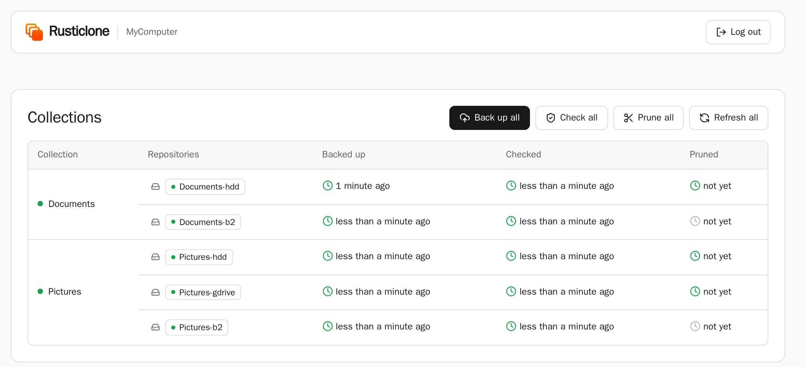

# Rusticlone

<picture>
  <source media="(prefers-color-scheme: dark)" srcset="https://raw.githubusercontent.com/AlphaJack/rusticlone/HEAD/screenshots/web-dark-collections.png">
  
</picture>

<!-- ANCHOR: intro -->
Rusticlone backs up your desktops and servers on a schedule, sends copies to separate locations and warns you when something needs your attention.
It is based on [rustic](https://rustic.cli.rs/) and it makes it easy to implement a [3-2-1-1-0 backup strategy](https://www.backblaze.com/blog/whats-the-diff-3-2-1-vs-3-2-1-1-0-vs-4-3-2/#:~:text=What%20Is%203-2-1-1-0%3F).

## Philosophy

- Zero lock-in: your backups are interoperable with rustic, [restic](https://restic.net/) and its [ecosystem](https://github.com/rubiojr/awesome-restic)
- Simple mental model: back up (snapshot) your files to a repository, copy that snapshot to other repositories, and mark old snapshots for deletion
- Set and forget with minimal effort: add 2 lines to your existing rustic profiles and you are good to go
- Lightweight and accessible: one small binary that you can run from the command line, from your desktop tray or as a web app
- Quiet and reliable: it notifies you only when there are issues, not at every run
<!-- ANCHOR_END: intro -->

Read the [documentation](https://alphajack.github.io/rusticlone/) to understand how to [install](https://alphajack.github.io/rusticlone/install.html), [back up](https://alphajack.github.io/rusticlone/getting-started.html) and [restore](https://alphajack.github.io/rusticlone/restore.html) your files.

## Contributions

- Something is not clear or you found a bug? Please open an [issue](https://github.com/AlphaJack/rusticlone/issues).
- [CONTRIBUTING.md](CONTRIBUTING.md): developer guidelines to submit PRs

## Credits

Special thanks to the teams behind rustic and restic, which made all of this possible!
